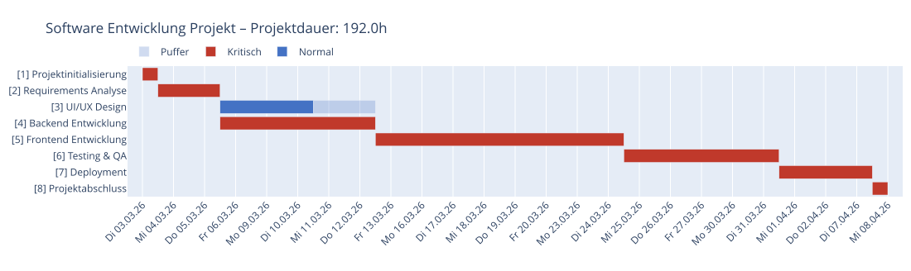
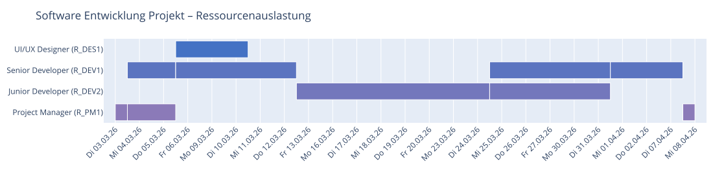

# Kommandozeile (CLI)

> Teil der [moncapro-Dokumentation](../../README.md#documentation). English: [doc/en/cli.md](../en/cli.md)

## Verwendung

### Einzelnes Projekt verarbeiten

Gib eine Projektdatei an (z. B. `newproject.json`). Ohne `--project` werden alle `project*.json` im
Datenordner (`./data` bzw. `$MONCAPRO_DATA`) verarbeitet. `python -m moncapro` entspricht `moncapro`.
Die Beispielprojekte liegen im Paket (`src/moncapro/examples/` im Repository,
`moncapro.paths.get_examples_dir()` nach der Installation).

```bash
moncapro --project newproject.json

```

### Exportformat wählen

```bash
# Nur JSON (Standard)
moncapro --project src/moncapro/examples/tankdesign.json

# Mehrere Formate gleichzeitig
moncapro --project src/moncapro/examples/hausbau.json --export txt,json,xlsx,md,html,zip

# Alle verfügbaren Formate
moncapro --project src/moncapro/examples/software_simple.json --export txt,json,xlsx,md,html,zip
```

### Alle Projekte im Verzeichnis verarbeiten

```bash
moncapro --data-dir src/moncapro/examples --export json
```

### Weitere Optionen

```bash
# Ausgabeverzeichnis angeben
moncapro --project src/moncapro/examples/pizza.json --output-dir ./meine_ergebnisse

# Startdatum überschreiben
moncapro --project src/moncapro/examples/simpleproject.json --start-date 2026-06-01

# Konfigurationsverzeichnis
moncapro --project src/moncapro/examples/pizza.json --cfg-dir ./cfg

# Ausführliche Ausgabe
moncapro --project src/moncapro/examples/pizza.json --verbose

# Alle Szenarien mit dem Basisplan vergleichen / ein Szenario statt des Basisplans rechnen
moncapro --project src/moncapro/examples/software_simple.json --scenarios
moncapro --project src/moncapro/examples/software_simple.json --scenario "Alice eine Woche krank" --export xlsx

# Monte-Carlo-Simulation mit 500 Läufen (reproduzierbar mit --seed)
moncapro --project src/moncapro/examples/software_simple.json --simulate 500 --seed 42

# Kleine interaktive HTML-Charts: plotly.js aus dem Internet laden statt einbetten (~4 MB)
moncapro --project src/moncapro/examples/software_simple.json --export plotly,simulation --plotly-cdn

# Hilfe
moncapro --help
```

### Exportformate

| Format | Beschreibung |
| ------ | ------------ |
| `json` | Netzplan + Gantt als JSON (Standard) |
| `txt` | Strukturierte ASCII-Textdatei |
| `xlsx` | Excel mit konfigurierbaren Tabs (via `cfg/excel_export.cfg`) |
| `md` | Markdown-Report mit eingebetteten Mermaid-Diagrammen |
| `html` | HTML-Report, Mermaid-Diagramme werden im Browser gerendert |
| `zip` | Alle Diagramme als SVG in einem ZIP-Archiv (via Mermaid/kroki.io) |
| `plotly` | Interaktive HTML-Charts (Gantt, Ressourcen) |
| `plotly_svg` | Die Plotly-Charts als SVG-Bilder (braucht kaleido und ein lokales Chrome) |
| `scenarios` | Szenario-Vergleich als HTML |
| `simulation` | Monte-Carlo-Simulation als HTML (Histogramm, Kritikalität, Kennzahlen) |

Diagramme von `--export plotly` (interaktives HTML) und `--export plotly_svg` für `src/moncapro/examples/software_simple.json`:





## Ausgabestruktur (CPM-Tabelle)

```text
ID      Name                           Dauer    FAZ    FEZ    SAZ    SEZ    GP     FP     Krit.
─────────────────────────────────────────────────────────────────────────────────────────────
1       Planung                        3d       0.0    3.0    0.0    3.0    0.0    0.0    JA
2       Umsetzung                      10d      3.0    13.0   3.0    13.0   0.0    0.0    JA
3       Abnahme                        2d       13.0   15.0   13.0   15.0   0.0    0.0    JA
```

| Kürzel | Bedeutung                  |
| ------ | -------------------------- |
| FAZ    | Frühester Anfangszeitpunkt |
| FEZ    | Frühester Endzeitpunkt     |
| SAZ    | Spätester Anfangszeitpunkt |
| SEZ    | Spätester Endzeitpunkt     |
| GP     | Gesamtpuffer               |
| FP     | Freier Puffer              |

## Logging

Logdateien werden automatisch unter `log/` erstellt:

- Format: `moncapro_YYYYMMDD_HHMMSS.log`
- Konsole: INFO-Level (wichtige Meldungen)
- Datei: DEBUG-Level (vollständige Details)
