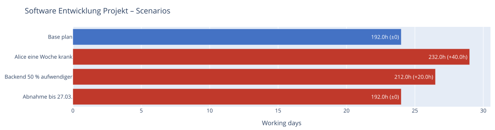
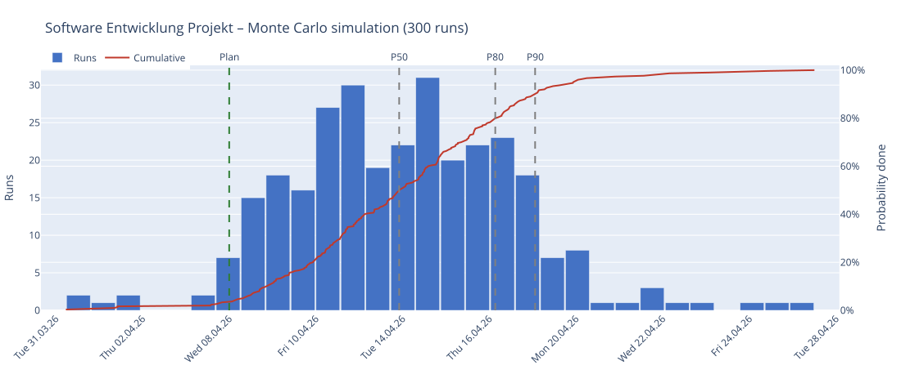

# Dates, Resources, and Plan vs. Actual

> Part of the [moncapro documentation](../../README.md#documentation). Deutsch: [doc/de/termine-und-ist.md](../de/termine-und-ist.md)

All information described here is optional. Without it, moncapro calculates as before.

## Fixed Dates

Per task in the project file:

```json
{ "id": 3, "name": "Pour foundation", "duration": "2d",
  "not_before": "2026-04-15",
  "deadline":   "2026-04-30" }
```

| Field | Meaning |
| --- | --- |
| `not_before` | Earliest start (e.g. material delivery). A date without a time means start of day. |
| `deadline` | Latest finish. A date without a time means end of day. |

A missed deadline shows up as negative slack and as a warning in the CLI, TXT, Markdown, JSON,
sproject GUI, and the Plotly Gantt chart (red diamond). For loop and instance tasks, `not_before`
applies to the first cycle, `deadline` to the last.

## Resources: who can do how much at the same time?

| Resource | Simultaneous tasks |
| --- | --- |
| with `count` | `count` |
| `machine` / `oven` with `capacity` | `capacity` (e.g. an oven with 4 slots) |
| `material` | unlimited |
| all others (persons, trucks, excavators, …) | 1 |

For trucks, `capacity` is the **load capacity** (m³), not the number of parallel trips.

If tasks share a resource, moncapro schedules them one after another. This waiting relationship
counts like a dependency — slack and the critical path are adjusted to match the scheduled sequence.
The Plotly tooltip shows how much a task was delayed and which task it's waiting on.

## Vacation and Part-Time

On the person (`persons`):

```json
{ "id": "DEV1", "name": "Alice", "role": "Developer", "hourly_rate": 85,
  "vacation": [ { "from": "2026-04-01", "to": "2026-04-05", "description": "Vacation" },
                { "date": "2026-03-16", "description": "Training" } ],
  "workinghours_override": { "description": "half days", "days": ["mon", "tue", "wed", "thu", "fri"],
                             "hours": [ { "from": "08:00", "to": "12:00" } ] } }
```

- **Vacation** interrupts a task; it continues after the vacation.
- **Part-time** slows a task down (4h of 8h → half speed, double duration).
- If several people work on a task, the least available person determines the pace.

## Plan vs. Actual

At the project level:

```json
"status_date": "2026-03-13",
"actuals": {
  "1": { "start": "2026-03-03 09:00", "finish": "2026-03-03 13:00" },
  "4": { "start": "2026-03-06", "progress": 0.6 },
  "5": { "start": "2026-03-12", "remaining": "2d", "note": "Estimate after review" }
},
"baseline": { "created": "...", "project_end": "...", "tasks": { "...": { "start": "...", "finish": "..." } } }
```

| Field | Meaning |
| --- | --- |
| `status_date` | Reference date of the actual state (end of day). Tasks not yet started begin no earlier than this date. |
| `actuals` | Actual state per task ID (also expanded IDs such as `2-F1.1`). |
| `start` + `finish` | done — fixed. |
| only `start` | in progress — remaining work from the reference date, taken from `remaining` or `duration × (1 − progress)`. |
| `baseline` | frozen plan, not maintained by hand (see below). |

**Saving a baseline** (once, when the plan is signed off):

```bash
moncapro --project my_project.json --save-baseline
```

or in the sproject GUI, in the results tab "Save baseline" and then save the project.

Output: reference date, completed/in-progress tasks, forecast end, baseline end, and delay in all
reports; in the Gantt chart, a gray baseline bar under each task, the completed portion in green, and
a reference-date line. Example: [src/moncapro/examples/software_simple_ist.json](../../src/moncapro/examples/software_simple_ist.json).

## Scenarios (What If?)

Named variants of the plan at the project level. The base plan stays unchanged.

```json
"scenarios": [
  { "name": "Alice sick for a week",
    "changes": [ { "person": "DEV1", "vacation": [ { "from": "2026-03-09", "to": "2026-03-13", "description": "sick" } ] } ] },
  { "name": "Traffic jam: transports 20% slower",
    "changes": [ { "task": "2-F*.2", "duration_factor": 1.2 } ] },
  { "name": "Truck L1 broken down",
    "changes": [ { "resource": "L1", "unavailable": [ { "from": "2026-03-04", "to": "2026-03-05", "description": "Breakdown" } ] } ] },
  { "name": "Delivery 3 days later",
    "changes": [ { "task": 3, "delay": "3d" } ] }
]
```

| Change | Effect |
| --- | --- |
| `task` | Task ID or pattern (`2-F*.2` = all transports, including expanded cycles). `duration_factor` multiplies the duration; any other field (`duration`, `delay`, `resources`, `deadline`, `not_before`, …) is set directly. |
| `resource` + `unavailable` | additional downtime for the resource |
| `person` + `vacation` | additional absences for the person |

`delay` (wait time before start) and `unavailable` (resource downtime, e.g. maintenance) can also be
used directly in the base plan.

```bash
moncapro --project my_project.json --scenarios                   # comparison table
moncapro --project my_project.json --export scenarios            # comparison as HTML
moncapro --project my_project.json --scenario "Truck L1 broken down" --export txt,plotly
```

In the sproject GUI, the comparison appears in the results tab ("Scenarios" section).



*Scenario comparison (`--export scenarios`) for `src/moncapro/examples/software_simple.json`:* Each bar is
the project duration of a variant, blue the base plan, red the deviations with their extra time compared
to the base plan. The table below lists end date, duration, cost, and missed deadlines — "Acceptance by
Mar 27" doesn't change the duration but misses a deadline.

## Monte Carlo Simulation (How Certain Is the Date?)

moncapro runs the plan many times with random variations. Uncertainty is specified in three places:

```json
{ "id": 4, "name": "Backend development", "duration": "40h",
  "duration_range": ["32h", "72h"],
  "risk": { "probability": 0.2, "delay": "16h", "note": "Customer API still unstable" } }
```

```json
"scenarios": [ { "name": "Alice sick for a week", "probability": 0.15, "changes": [ ... ] } ]
```

| Setting | Effect per run |
| --- | --- |
| `duration_range` | Duration varies randomly between minimum and maximum, most often the planned duration (triangular distribution) |
| `risk` | with `probability`, the start is delayed by `delay` |
| scenario with `probability` | the scenario occurs with this probability |

```bash
moncapro --project my_project.json --simulate 500 --seed 1          # metrics
moncapro --project my_project.json --export simulation --simulate 500
```

Result: the probability that the plan (and baseline, deadlines) will be met, P50/P80/P90 ("80% done
by …"), earliest/latest end, and **criticality** — how often a task was on the critical path. The HTML
output shows a histogram and a cumulative curve. `--seed` makes runs reproducible. In the sproject GUI:
export dialog "Simulation (HTML)".



*Simulation with 300 runs (`--export simulation`) for `src/moncapro/examples/software_simple.json`:*

- **Bars** — how many runs finished on which day.
- **Red cumulative curve** (right axis) — the probability that the project is finished by this day.
- **Green "Plan" line** — the plan's end date without variation; here it is only met in 3% of runs.
- **P50 / P80 / P90** — by this point, 50/80/90% of runs are finished. For a reliable commitment, P80
  or P90 is a better choice than the plan.
- The table lists the same metrics and how often a scenario with `probability` occurred.


**Criticality:** share of runs in which a task was on the critical path. Tasks at 100% always
determine the project end; tasks with a high share (here backend and frontend at 90%) are the best
candidates for slack, additional staff, or more accurate estimates.
