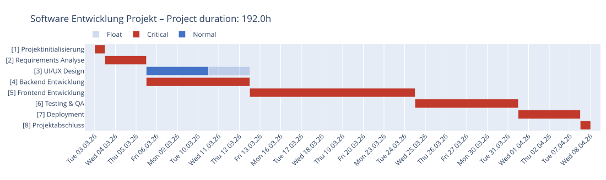

# Command Line (CLI)

> Part of the [moncapro documentation](../../README.md#documentation). Deutsch: [doc/de/cli.md](../de/cli.md)

## Usage

### Process a single project

Pass a project file (e.g. `newproj.json`). Without `--project`, all `project*.json` files (or, if there are none, all `*.json` files) in the data
folder (`./data`, or `$MONCAPRO_DATA`) are processed. `python -m moncapro` works the same as `moncapro`.
The example projects ship with the package (`src/moncapro/examples/` in the repository,
`moncapro.paths.get_examples_dir()` when installed).

```bash
moncapro --project newproj.json
```

### Choose export format

```bash
# JSON only (default)
moncapro --project src/moncapro/examples/tankdesign.json

# Multiple formats at once
moncapro --project src/moncapro/examples/hausbau.json --export txt,json,xlsx,md,html,zip

# All available formats
moncapro --project src/moncapro/examples/software_simple.json --export txt,json,xlsx,md,html,zip
```

### Process all projects in a directory

```bash
moncapro --data-dir src/moncapro/examples --export json
```

### Additional options

```bash
# Custom output directory
moncapro --project src/moncapro/examples/pizza.json --output-dir ./my_results

# Override start date
moncapro --project src/moncapro/examples/simpleproject.json --start-date 2026-06-01

# Custom config directory
moncapro --project src/moncapro/examples/pizza.json --cfg-dir ./cfg

# Verbose output
moncapro --project src/moncapro/examples/pizza.json --verbose

# Compare all scenarios with the base plan / calculate one scenario instead of the base plan
moncapro --project src/moncapro/examples/software_simple.json --scenarios
moncapro --project src/moncapro/examples/software_simple.json --scenario "Alice eine Woche krank" --export xlsx

# Monte Carlo simulation with 500 runs (reproducible with --seed)
moncapro --project src/moncapro/examples/software_simple.json --simulate 500 --seed 42

# Small interactive HTML charts: load plotly.js from the internet instead of embedding it (~4 MB)
moncapro --project src/moncapro/examples/software_simple.json --export plotly,simulation --plotly-cdn

# Help
moncapro --help
```

### Export Formats

| Format | Description |
| ------ | ----------- |
| `json` | Network plan + Gantt as JSON (default) |
| `txt` | Structured plain-text report |
| `xlsx` | Excel with configurable tabs (via `cfg/excel_export.cfg`) |
| `md` | Markdown report with embedded Mermaid diagrams |
| `html` | HTML report — Mermaid diagrams rendered in the browser |
| `zip` | All diagrams (Gantt, network plan, resource Gantts) as SVG files in a ZIP archive (rendered via kroki.io) |
| `plotly` | Interactive HTML charts (Gantt, resources) |
| `plotly_svg` | The Plotly charts as SVG images (needs kaleido and a local Chrome) |
| `scenarios` | Scenario comparison as HTML |
| `simulation` | Monte Carlo simulation as HTML (histogram, criticality, key figures) |

> **Excel tabs** (Gantt chart, resource list, etc.) are controlled by `section_order` in `cfg/excel_export.cfg` — no command-line flags needed.

Charts of `--export plotly` (interactive HTML) and `--export plotly_svg` for `src/moncapro/examples/software_simple.json`:




## CPM Output Structure

```text
ID      Name                           Duration  ES     EF     LS     LF     TF     FF     Crit.
─────────────────────────────────────────────────────────────────────────────────────────────────
1       Planning                       3d        0.0    3.0    0.0    3.0    0.0    0.0    YES
2       Implementation                 10d       3.0    13.0   3.0    13.0   0.0    0.0    YES
3       Acceptance                     2d        13.0   15.0   13.0   15.0   0.0    0.0    YES
```

| Column | Meaning              |
| ------ | -------------------- |
| ES     | Earliest Start       |
| EF     | Earliest Finish      |
| LS     | Latest Start         |
| LF     | Latest Finish        |
| TF     | Total Float          |
| FF     | Free Float           |

## Logging

Log files are created automatically under `log/`:

- Format: `moncapro_YYYYMMDD_HHMMSS.log`
- Console: INFO level (key messages)
- File: DEBUG level (full details)
