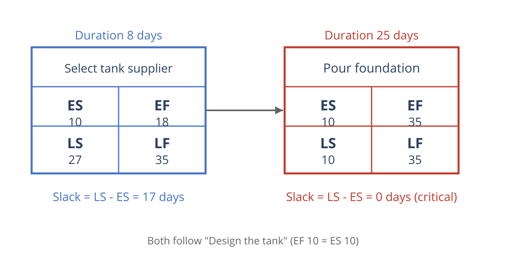

# Critical Path Method: The Beginnings

> Part of the [moncapro documentation](../../README.md#documentation). Deutsch: [doc/de/critical-path-method.md](../de/critical-path-method.md)

The critical path method was first used in the late 1950s in two simultaneous but independent projects. The US Navy's Polaris missile program was behind schedule and needed a solution. The proposed approach was to break the program down into several thousand tasks, represent each task with an arrow, connect the arrows in the correct order, and estimate the duration and critical importance of each task for the overall schedule.

Around the same time, EI DuPont de Nemours Company, an American chemical company, had scheduling problems while redistributing production across different plants. A solution was needed here too, and the proposed approach was similar to the one used for the Polaris program.

The developers of the method for the Polaris program called their solution Project Evaluation and Review Technique (PERT). At DuPont, it was called the Critical Path Method (CPM). The two methods are similar but use different approaches to estimating task duration.

PERT uses three different time estimates for each task and calculates the probability of project completion for any given point in time. DuPont's approach, by contrast, uses only one time estimate per task and considers not only the completion date but also the additional costs that would result from a shortened project duration.

Today, according to Bennett, "the terms PERT and CPM are used interchangeably; both refer to any method of network scheduling, and the term PERT is no longer associated with triple estimation and probabilities."

## Critical Path in Project Management: Everyday Benefits

The critical path dates back to the 1950s, but it is still extremely important for project managers today. The critical path visually represents project activities, clearly shows the time required to complete tasks, and tracks activities to help you stay on schedule. The critical path method also reduces uncertainty, because you have to calculate the shortest and longest time for each task. This forces you to account for unexpected factors that could affect task completion and reduces the likelihood of an unexpected incident during the course of the project.

According to Bennett, the critical path method has three key benefits for project managers:

1. *Identifying the most important tasks*: The critical path plays a crucial role in identifying the most important tasks. It clearly determines which tasks need to be closely monitored. Any delays, lateness, or deviations in critical path tasks have an immediate impact on the entire project.
2. *Shortening the timeframe*: "Once the initial analysis has predicted the project completion date and there's interest in finishing the project faster, the task or tasks that can achieve this time reduction can be clearly identified," says Bennett. By displaying the critical paths and task durations in a Gantt chart, you can easily see where in the schedule these tasks fall. You can visualize both the activities on the critical path (usually highlighted) as well as the task durations and sequence. This gives you new insight into the project's timeline and helps you better understand which task durations are flexible and which cannot be changed.
3. *Comparing plan (target) to execution (actual)*: Bennett also notes that the critical path in project management can be used to compare planned progress with actual progress. "As a project is executed, the underlying schedule from the critical path analysis can be used to track progress. Throughout a project, project managers can identify tasks that have already been completed. They can also determine how much longer other ongoing tasks will take, and check whether there are planned changes to future task sequences and durations. The result is an updated schedule that, compared with the original schedule, provides a visually compelling comparison of planned versus actual progress."

## Critical Path Example: The Key Steps

The critical path method consists of six steps:

### Step 1: Identify all activities

Identify all activities or tasks of the project using the work breakdown structure (WBS). This list of activities should only include high-level activities. Listing detailed activities can make the critical path overly complex and therefore confusing and hard to manage.

The work breakdown structure divides a project into several manageable sections.

The first step is to identify the deliverables of a project. The high-level activities can then be broken down into smaller work packages.

How you represent your work breakdown structure is up to you: as a tree, a list, or a table. A rough overview or outline is one of the simplest ways to represent a work breakdown structure.

### Step 2: Determine the dependencies (sequence of activities)

Some activities depend on the completion of other activities. Listing the direct predecessors of each activity helps you determine the correct sequence. To correctly identify activities and their predecessors, it helps to answer the following questions for each activity from step 1:

- Which tasks must be completed before this task can begin?
- Which tasks must be completed at the same time as this task?
- Which tasks should begin immediately after this task?

### Step 3: Design the network diagram

After you have determined the activities and their dependencies, you can design the network diagram (Critical Path Analysis Chart, CPA). The network diagram is a visual representation of the sequence of your activities based on their respective dependencies.

In the past, the network diagram was drawn by hand; today there is software for this.

### Step 4: Estimate the time required for the activities

Based on your own experience or the knowledge of experienced staff, estimate how much time is needed to complete each task. For smaller projects, time can often be estimated in days. For large and complex projects, estimating in weeks is more likely.

If you are unsure about your estimates, you can use the three-point estimating technique (also known as the three-time estimate) to arrive at a more realistic estimate.

The three-point estimating technique requires three time estimates for each task, based on previous experience or best-guess estimates. The time required is calculated using the following values:
```
a = optimistic estimate (best case)
m = most likely estimate (most likely case)
b = pessimistic estimate (worst case)
```

These three formula values determine the best-case, most likely, and worst-case scenarios.

Once you have determined these values, you can use them in two different formulas. The first formula calculates the average duration, giving the most likely value a strong weighting. The formula is shown below. "E" stands for the estimate, and 4 and 6 represent the conventional method, which places more weight on the most realistic value.

```
E = (a + 4m + b) / 6
```

The second option is to use the values above in what is known as the triangular distribution. The key difference from the first option is that this method does not place additional weight on the most likely value. The formula is shown below. "E" stands for the estimate, and 3 represents the conventional method.

```
E = (a + m + b) / 3
```

### Step 5: Identify the critical path


This is how moncapro displays the critical path: in the Gantt chart, tasks on the critical path are highlighted in
red, tasks with slack in blue.

There are now two ways to identify the critical path. You can either visually find the longest path in your network diagram, i.e. the path with the longest sequence of activities. Make sure it is the path with the longest duration in days, not the path with the most boxes or nodes.

Alternatively, you can determine critical activities using forward or backward pass scheduling. This identifies the earliest start (ES) and finish (EF) times, as well as the latest start (LS) and finish (LF) times, for each activity.

If there are multiple critical paths in a project, network stability often becomes an issue. A schedule is considered unstable if the critical path is likely to change after the project starts. The more critical paths a project contains, the higher the likelihood of changes to the schedule.

### Step 6: Update the critical path diagram to show progress

As the project progresses, you'll see how much time each task actually takes to complete. Based on this information, you can then update the schedule instead of continuing to work with estimates.

Updating the network with new information may require you to recalculate the critical path. You will also have a more realistic estimate of the project end date and can determine whether you are on schedule or experiencing delays.

## Critical Path: Other Scenarios

One of the biggest benefits of the critical path in project management is identifying key tasks that, if not completed on time, will affect the end date of the entire project. You also gain insight into the project status and can see whether you are on schedule.

#### Compressing the schedule

During a project, you may want to intentionally shorten the project duration or need to compress the project schedule to meet a deadline. The critical path method offers two ways to do this: fast tracking and crashing.

##### Fast tracking

With fast tracking, you look at the critical path and decide which activities can be performed in parallel to speed up the project. You only need to consider activities on the critical path, since all other activities have slack (float), and shortening them only increases their slack.

Fast tracking reduces the project timeframe, but it also carries risk, since you're now running activities in parallel that were originally planned in sequence.

##### Crashing

Crashing refers to the shortest time budgeted for an activity in the schedule. This compression can be achieved by allocating additional resources to the activity. However, crashing can also lead to lower quality work, since the goal of crashing is speed.

### Handling scarce resources

During a project, you may also be confronted with scarce resources, which can cause the critical path to change. When you schedule activities at the same time, you may need more staff than are actually available. As a result, you have to reschedule these activities. Resource leveling is used to resolve these bottlenecks.

#### Resource leveling and expansion

Resource leveling lets you resolve conflicts in resource assignment. A schedule that has been resource-leveled may contain delays due to bottlenecks, for example when a staff resource is not available at the required time.

Resource leveling can also cause a previously shorter path to become the longest path, or the path with the most critical resources. This happens when activities on the critical path are affected by scarce resources.

A related concept is the critical chain, which aims to avoid unexpected delays in activities and project duration due to scarce resources.

### Assessing the final project

The above describes how unexpected changes during a project can affect the critical path. But even when things are constantly in flux, you can still determine the deviation from the original project schedule and understand whether and how it affects the final project.

- *Flexibility and assessing delays*

A schedule created using the critical path method naturally contains a lot of variability, since the time calculations are based on best-guess estimates. If an error occurred in the time estimate for completing a task, this can change the entire critical path. You may also deliberately delay certain project activities due to resource bottlenecks.

If you recognize these delays and understand the reasons behind them, you can avoid similar problems in the future. An important part of the project post-analysis is examining the specific reasons and interactions between changes to the project schedule and the actual timeline as executed (as-built critical path). This schedule contains the actual dates of the executed activities along with their allotted time and determines responsibility for delays on the critical path.

### Critical Path: Software

In the beginning, the critical path method was drawn by hand as a network diagram with nodes representing the various stages of a project. The nodes were then connected with arrows.

However, manually creating network diagrams is time-consuming and difficult, especially when things keep changing at the start of a project.

Instead of hand-drawn network diagrams, there are now a number of project management software programs that display the critical path with a mouse click.

To explain how to draw a network diagram, Bennett created a sample project with eight tasks:

    **Project**: Design a tank. Project duration: 10 days. Project start: immediately.

    1. Pour foundation (25 days) and select tank supplier (8 days) can start once the tank design is complete.
    2. Manufacture tank components (10 days) can start once the tank supplier has been selected.
    3. Deliver the tank to the site (4 days) can start once the components are complete.
    4. Drawings for installation (3 days) can start once the tank supplier has been selected.
    5. Erect the tank (15 days) can start once the tank has been delivered to the site, the installation drawings are available, and the foundation is complete.
    6. Testing and commissioning the tank (4 days) can start once the tank is erected.
    7. The project is complete once testing and commissioning are done.

To determine the critical path, you must first draw a network diagram.

Here's how it works:

    - Draw a box for your first activity (design the tank). Enter the duration in days (10 days).
    - Next, draw boxes for the following activities (pour foundation, select tank supplier). Use arrows to show the sequence of activities starting from the tank design.
    - Follow the same pattern to draw boxes for the other activities and arrows to indicate when an activity can begin.

With the completed network diagram, you can now determine the critical path. Remember: the critical path is the duration of the longest path in the network diagram, not the path with the most boxes (nodes).

In this example, the critical path is: design the tank – pour foundation – erect the tank – testing and commissioning, with a total duration of 54 days.

You can determine the critical path with the longest duration in days visually, or by using the forward and backward pass method described in the next section.

## Forward and Backward Pass to Determine the Critical Path

Forward/backward pass scheduling is another method for determining the critical path. It works best for branching activities or activities with multiple entry points.

The forward/backward pass may also be necessary when you need to determine the earliest or latest start or finish times of an activity, or when you need to determine how much slack exists for individual activities.

Before applying the forward/backward pass method, here are a few key **terms**:

    1. Earliest start **(ES)**: The earliest point in time an activity can begin, once the preceding activities are complete.
    2. Earliest finish **(EF)**: The earliest start time plus the time needed to complete the activity (the earliest point in time an activity can be finished).
    3. Latest finish **(LF)**: The latest point in time an activity can be completed without delaying the entire project.
    4. Latest start **(LS)**: The latest finish time minus the time needed to complete the activity.

When applying the forward/backward pass, use the following legend for your network diagram:



Each activity is represented as a node with six fields: the name at the top, ES on the middle left
and EF on the middle right, LS on the bottom left and LF on the bottom right. Both nodes in the tank
example follow the tank design (EF 10 = ES 10). Selecting the tank supplier has 17 days of slack
(LS ≠ ES); pouring the foundation is on the critical path — there, ES = LS and EF = LF, so slack is
zero.

### Forward Pass: Formula for the Earliest Start and Finish Times

There are two formulas for the forward/backward pass. The first formula, for the forward pass, is used when moving through the network diagram from start to end (from the first to the last activity). This formula calculates the earliest start (ES) and earliest finish (EF) time for each task.

Enter 0 as the ES for the first task. For all other tasks, the ES is identical to the EF of the immediate predecessor.

The EF is calculated as follows:

```
EF = ES + duration (node time)
```
For designing the tank, the ES is 0 and the EF is 10 (10 + duration of 0). It also follows that the ES for selecting the tank supplier is 10 and the EF is 18 (10 + duration of 8). Perform the same calculations for the entire network diagram.

### Backward Pass: Formula for the Latest Start and Finish Times

The second formula, for the backward pass, is used when moving from the last activity to the first (i.e. backward). This formula calculates the latest start (LS) and latest finish (LF) time for each task.

For the backward pass, enter the same value for the last task's latest finish (LF) as its earliest finish (EF). For all other tasks, the LF is identical to the LS of the immediate successor.

The LS is calculated as follows:

```
LS = LF - duration (node time)
```

For testing and commissioning the tank, the LF is 54 and the LS is 50 (54 minus a duration of 4). For erecting the tank, the LF is also 50 and the LS is 35 (50 minus a duration of 15). Perform the same calculations for the entire network diagram.

If you have performed the backward pass correctly, the latest start (LS) of the first activity (activity 1) will be 0.

### Two Rules for Forward and Backward Pass Scheduling in Project Planning

When you encounter merging activities during the forward pass (multiple activities converging on one node), the forward pass must be calculated for each entry point, using the highest value.

When you encounter merging activities during the backward pass, the formulas must be calculated for each entry point using the lowest value.

### Calculating Slack

Once you have entered the earliest start (ES) and latest start (LS) for each activity, you can determine the slack.

Slack for an activity is the time between the earliest and latest start time. Critical activities, i.e. activities on the critical path, have zero slack.

In the forward and backward pass, slack can be calculated using two formulas:
```
Slack = LF - EF

Slack = LS - ES
```

These formulas help you calculate the slack of activities. If you're unsure which activities are on the critical path, remember that slack can be revealing, since the slack of activities on the critical path is always zero.

The diagram below shows the slack for each task. You can see that the activities on the critical path – design the tank – pour foundation – erect the tank – testing and commissioning – all have zero slack.

Since duration estimates are uncertain, the critical path can change over time — this is exactly what
moncapro's Monte Carlo simulation addresses: it varies durations across many runs and counts how often
each task was on the critical path (the *criticality*):


Tasks with high criticality deserve special attention, as they tend to remain on the critical path even
under uncertainty.

## Critical Path: Key Terms

Here are the most important terms of the critical path method:

  - **Critical Path Method (CPM)**: A step-by-step project management method used to identify critical and non-critical tasks during process planning in order to avoid scheduling conflicts and time bottlenecks.
  - **Critical Path DRAG (Devaux's Removed Activity Gauge)**: The amount of time an activity on the critical path adds to the overall project duration. Or the amount of time the overall duration would be reduced if the duration of an activity on the critical path were reduced to zero.
  - **Criticality index**: A term from risk analysis that shows how often a particular task was on the critical path. Tasks with a high criticality index are more likely to cause project delays, since they are more likely to be on the critical path.
  - **Earliest start (ES)**: The earliest point in time an activity can begin, after the activities it depends on have been completed.
  - **Earliest finish (EF)**: The earliest start time of an activity plus the time required to complete it.
  - **Latest finish (LF)**: The latest point in time an activity can be completed without delaying the entire project.
  - **Latest start (LS)**: The latest finish time of an activity minus the time required to complete it.
  - **Total slack**: The amount of time an activity's earliest start can be delayed without delaying the overall project.
  - **Free slack**: The amount of time an activity can be delayed without delaying the earliest start of a successor activity.
  - **Forward pass**: Method used to calculate the earliest start or finish times of activities on the critical path.
  - **Backward pass**: Method used to calculate the latest start or finish times of activities on the critical path.
  - **Network diagram**: Schematic representation of the relationships between activities within a project. The flow is always drawn from left to right to indicate the sequence.
  - **Network analysis**: Breaking down a complex project into individual components (activities, duration, etc.) as a work breakdown structure, showing dependencies and relationships between them.

Full details at

https://de.smartsheet.com/critical-path-method
